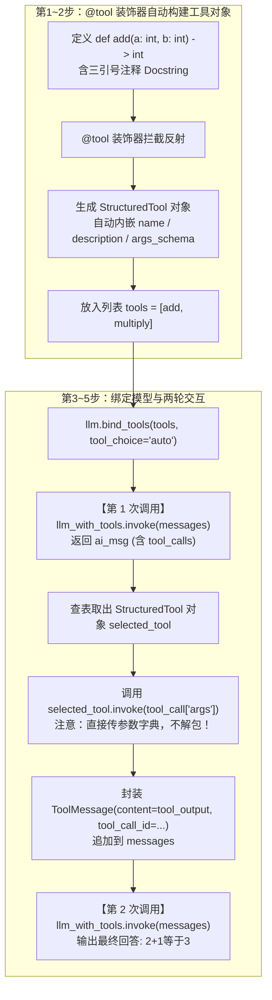

# `02-装饰器方式.py` 源码精讲：使用 LangChain `@tool` 装饰器告别手写 JSON Schema

---

## 一、文件定位与核心前置知识精讲

### 1.1 文件定位
`前置知识/2-Function Call/02-装饰器方式.py` 是 `2-Function Call` 模块的**第 2 课（工程提效篇）**。在上一课 [`01-基本调用.py`](./01-基本调用.py.md) 中，为了暴露 `add` 和 `multiply` 两个只有 1 行代码的简单函数，我们被迫手写了整整 44 行的 JSON Schema 字典，既繁琐又容易写错括号。
本文件引入了 LangChain 核心库提供的 **`@tool` 装饰器**（`from langchain_core.tools import tool`），演示如何让框架通过**自动反射函数的名称、类型注解（Type Hints）与三引号文档字符串（Docstring）**，在底层自动生成 JSON Schema，将代码量直接砍掉近三分之一！

---

### 1.2 核心前置知识

#### （1）`@tool` 装饰器到底在底层做了什么魔法？
当你在普通函数 `def add(a: int, b: int) -> int:` 头顶加上 `@tool` 时：
1. **身份蜕变（从 `function` 变成 `StructuredTool` 对象）**：
   - 被 `@tool` 装饰后，`add` 变量不再是一个普通的 Python 函数（`<function add>`），而是被包装成了一个 **`langchain_core.tools.structured.StructuredTool` 类的实例对象**！
2. **自动提取三要素生成 JSON Schema**：
   `StructuredTool` 在创建时会自动使用 Python 的 `inspect` 模块检查原函数：
   - **提取函数名 `add`** $\rightarrow$ 作为 JSON Schema 的 `"name": "add"`；
   - **提取形参类型注解 `a: int, b: int`** $\rightarrow$ 自动映射为 JSON Schema 的 `"properties": {"a": {"type": "integer"}, "b": {"type": "integer"}}` 及 `"required": ["a", "b"]`；
   - **提取三引号注释 `"""将数字a与数字b相加..."""`** $\rightarrow$ 作为 JSON Schema 的 `"description"`！
3. **铁律：使用 `@tool` 装饰器时，函数必须写三引号注释（Docstring）和参数类型注解！**
   - 如果一个函数头顶加了 `@tool`，但函数体里**没有写三引号注释**，Python 在运行到 `@tool` 时会直接抛出 `ValueError: Function must have a docstring if description not provided.`！因为没有注释，大模型就失去了判断何时调用该工具的依据。

#### （2）核心差异对比：`selected_tool.invoke(tool_call["args"])` vs `selected_tool(**tool_call["args"])`
这是从 `01-基本调用.py` 过渡到 `02-装饰器方式.py` **最重要、最容易考**的知识点（对应本文件第 61~68 行注释）：
- 在 **`01-基本调用.py`** 中，`selected_tool` 是普通 Python 函数，调用时必须用 `**` 解包字典：`selected_tool(**tool_call["args"])`。
- 在 **`02-装饰器方式.py`** 中，`selected_tool` 是被 `@tool` 装饰后的 **`StructuredTool` 对象**！
  - `StructuredTool` 实现了 LangChain 统一的 Runnable 接口（`.invoke()` 方法）；
  - 调用 `selected_tool.invoke(...)` 时，**要求直接传入完整的参数字典 `tool_call["args"]`（绝对不能加 `**` 解包！）**，即：
    ```python
    tool_output = selected_tool.invoke(tool_call["args"])
    ```

---

### 1.3 在 Voyage 智途主项目中的关联
- 在后续的 `4-MCP协议`、`5-Agent智能体`（[`01-工具模式.py` ~ `05-多智能体模式.py`](../5-Agent智能体/01-工具模式.py.md)）以及主项目 `mcp_server/` 下的四个服务（[`mcp_weather.py`](../../mcp_server/mcp_weather.py.md)、[`mcp_ticket.py`](../../mcp_server/mcp_ticket.py.md)、[`mcp_trip.py`](../../mcp_server/mcp_trip.py.md)、[`mcp_external.py`](../../mcp_server/mcp_external.py.md)）中，全部采用这种**装饰器 + 类型注解 + 三引号文档注释**的范式来注册工具！

---

## 二、执行流程与示意图

### 2.1 `@tool` 装饰器自动转换与两轮调用流程图（Mermaid）



### 2.2 `@tool` 反射提取函数元信息示意图（ASCII）

```text
  @tool
  def add(a: int, b: int) -> int:
      """
      将数字a与数字b相加
      Args:
          a: 第一个数字
          b: 第二个数字
      """
      return a + b
         │
         │  @tool 装饰器在底层自动反射提取 (无需手写 40 行 JSON!)
         ▼
+-------------------------------------------------------------------+
| StructuredTool 实例对象 (赋值给变量 add)                          |
| ----------------------------------------------------------------- |
| • add.name        ===> "add"              (取自 def 函数名)       |
| • add.description ===> "将数字a与数字b相加\nArgs:\n..." (取自三引号)|
| • add.args        ===> {'a': {'type': 'integer'},                 |
|                         'b': {'type': 'integer'}} (取自类型注解)  |
| • 调用方式        ===> add.invoke({'a': 2, 'b': 1}) -> 返回 3     |
+-------------------------------------------------------------------+
```

---

## 三、完整源码与逐行/逐段深度拆解

### 3.1 完整源码（100% 原始文件嵌入）

文件路径：`前置知识/2-Function Call/02-装饰器方式.py`

```python
import os
from langchain_openai import ChatOpenAI
from langchain_core.messages import ToolMessage
from langchain_core.tools import tool

# todo: 第1步：定义工具函数
@tool # 使用langchain_core.tools.tool 装饰器，将函数定义为工具函数
def add(a: int, b: int) -> int:
    """
    将数字a与数字b相加
    Args:
        a: 第一个数字
        b: 第二个数字
    """
    return a + b

@tool
def multiply(a: int, b: int) -> int:
    """
    将数字a与数字b相乘
    Args:
        a: 第一个数字
        b: 第二个数字
    """
    return a * b

# todo: 第2步：将工具函数名（函数定义）添加到工具列表中
tools = [add, multiply]

# todo: 第3步：初始化模型
api_key = os.environ.get("AliApiKey")
ali_url = "https://dashscope.aliyuncs.com/compatible-mode/v1"
llm = ChatOpenAI(base_url=ali_url,
                 api_key=api_key,
                 model='qwen3.8-max',
                 temperature=0.1)
# todo: 第4步：绑定工具，允许模型自动选择工具
llm_with_tools = llm.bind_tools(tools, tool_choice="auto")

# todo: 第5步：调用回复
query = "2+1等于多少？"
messages = [('human', query)]
try:
    # TODO: 第1次调用
    ai_msg = llm_with_tools.invoke(messages)
    messages.append(ai_msg)
    print(f"\n第一轮调用后结果：\n{messages}")

    # 处理工具调用
    # 判断AIMessag对象中是否有tool_calls属性，且不为空列表
    if hasattr(ai_msg, 'tool_calls') and ai_msg.tool_calls:
        # 大模型可能生成多个工具调用，需要遍历处理
        for tool_call in ai_msg.tool_calls:
            '''tool_call["name"] 就是大模型告诉我们要使用的工具函数名
            tool_call["args"] 是大模型返回的使用工具函数所需的参数字典'''
            # TODO: 处理工具调用
            # 工具函数字典，根据工具名称映射到对应的函数
            tool_dict = {"add": add, "multiply": multiply}
            # 根据工具名称选择工具函数
            selected_tool = tool_dict[tool_call["name"].lower()]
            # TODO: ➡️ 工具函数.invoke(传整体参数不解包！)
            '''
            tools = [add, multiply] 
            列表元素是被装饰的函数定义，确切说是StructuredTool工具对象
            该方式极度依赖工具函数的三引号注释
            '''
            # selected_tool(形参=实参，。。。)
            tool_output = selected_tool.invoke(tool_call["args"])
            # 创建工具输出消息对象
            tool_message = ToolMessage(
                content=tool_output,
                # TODO langchain要求 tool msg 必须有这个id
                tool_call_id=tool_call["id"]
            )
            # 将工具输出消息添加到消息列表中
            messages.append(tool_message)
        print(f"\n第一轮对话结束，message中增加tool_output之后：\n{messages}")

        # TODO: 第2次调用，将工具结果传回模型以生成最终回答
        final_response = llm_with_tools.invoke(messages)
        print(f"\n最终模型响应：\n{final_response.content}")
    else:
        print("模型未生成工具调用，直接返回文本:")
        print(ai_msg.content)
except Exception as e:
    import traceback
    print(traceback.format_exc())
    print(f"模型调用失败: {str(e)}")
```

---

### 3.2 分段逐行深度拆解

#### 第一段：导入 `@tool` 装饰器并定义工具（第 1~28 行）
- **第 4 行**：`from langchain_core.tools import tool` 导入 `@tool` 装饰器。
- **第 7~25 行**：在 `add` 和 `multiply` 函数上方加上 `@tool`。
  - 注意函数的类型签名 `def add(a: int, b: int) -> int:` 和函数体内的三引号注释 `"""将数字a与数字b相加..."""`。现在，这段三引号注释不再只是给人看的注释，而是**直接决定大模型能否正确理解并选用该工具的核心 Prompt 数据**！
- **第 28 行**：`tools = [add, multiply]`
  - 对比 `01-基本调用.py` 中长达 44 行的 JSON 字典列表，这里只需要极其清爽的 1 行代码 `tools = [add, multiply]`！列表里的两个元素正是被 `@tool` 转换后的 `StructuredTool` 实例对象。

#### 第二段：初始化模型并绑定工具（第 30~38 行）
- 与 `01-基本调用.py` 相同，通过 `llm.bind_tools(tools, tool_choice="auto")` 将 `StructuredTool` 列表绑定到大模型上。`bind_tools` 内部会自动调用每个 `StructuredTool` 对象的 Schema 转换方法，将其序列化为大模型 API 所需的 JSON Schema 格式发送给阿里云百炼。

#### 第三段：两轮调用与 `selected_tool.invoke()` 执行（第 40~88 行）
- **第 45~47 行**：第 1 次调用 `llm_with_tools.invoke(messages)`，获取带有 `tool_calls` 的 `ai_msg` 并追加到 `messages` 中。
- **第 58~60 行**：
  - `tool_dict = {"add": add, "multiply": multiply}`：这里的字典值 `add` 和 `multiply` 是 `StructuredTool` 对象。
  - `selected_tool = tool_dict[tool_call["name"].lower()]`：取出对应的 `StructuredTool` 对象。
- **第 61~68 行（全篇最核心代码与注释）**：
  - `tool_output = selected_tool.invoke(tool_call["args"])`
  - 正如第 61~66 行注释所强调：因为 `selected_tool` 是 `StructuredTool` 工具对象，不再是普通 Python 函数，所以调用它的 `.invoke()` 方法时，**直接把 `tool_call["args"]`（即 `{'a': 2, 'b': 1}` 这个字典整体）传进去，不要加 `**` 解包！**
  - 甚至，你还可以直接把整个 `tool_call` 字典传给 `selected_tool.invoke(tool_call)`，LangChain 的 `StructuredTool.invoke()` 不仅能执行计算，还能自动帮你返回封装好的 `ToolMessage`（不过本代码为了教学清晰，传的是 `tool_call["args"]` 得到 `int` 返回值 `3`，再在第 70~74 行手动构造 `ToolMessage`）。
- **第 70~81 行**：构造带有 `tool_call_id=tool_call["id"]` 的 `ToolMessage`，追加到 `messages`，并发起第 2 次 `llm_with_tools.invoke(messages)` 获取最终自然语言回答。
- **第 85~88 行**：异常捕获块中新增了 `import traceback; print(traceback.format_exc())`，方便在调试时打印完整的异常调用栈。

---

### 3.3 沙盘推演（Dry Run）：追踪 `StructuredTool` 对象在运行时的真实状态

让我们代入 `query = "2+1等于多少？"`，看看 `02-装饰器方式.py` 在内存中的独特变化：

1. **装饰器执行完毕时（第 28 行 `tools = [add, multiply]`）**：
   - 在内存中检查 `type(add)`：结果不是 `function`，而是 `<class 'langchain_core.tools.structured.StructuredTool'>`。
   - 检查 `add.name` $\rightarrow$ `'add'`
   - 检查 `add.description` $\rightarrow$ `'将数字a与数字b相加\nArgs:\n    a: 第一个数字\n    b: 第二个数字'`
   - 检查 `add.args` $\rightarrow$ `{'a': {'title': 'A', 'type': 'integer'}, 'b': {'title': 'B', 'type': 'integer'}}`
2. **第 1 次调用大模型返回（第 45 行）**：
   - `ai_msg.tool_calls` 为：`[{'name': 'add', 'args': {'a': 2, 'b': 1}, 'id': 'call_d4e5f6', 'type': 'tool_call'}]`。
3. **工具匹配与 `.invoke()` 调用（第 60~68 行）**：
   - `selected_tool` = `StructuredTool(name='add', ...)`。
   - 执行 `selected_tool.invoke({'a': 2, 'b': 1})`：
     - `StructuredTool` 内部先用自动生成的 Pydantic 模型校验 `{'a': 2, 'b': 1}` 中 `a` 和 `b` 是否为合法的 `int`；
     - 校验通过后，在内部解包调用底层的原生 `add(a=2, b=1)`；
     - 返回 `tool_output = 3`。
4. **封装 `ToolMessage` 与第 2 次调用（第 70~81 行）**：
   - `tool_message = ToolMessage(content='3', tool_call_id='call_d4e5f6')` 追加进 `messages`。
   - 第 2 次调用 `llm_with_tools.invoke(messages)`，控制台打印最终响应：`2+1等于3。`。

---

## 四、常见易错点与对比总结

### 4.1 `01-基本调用.py` vs `02-装饰器方式.py` 核心差异对照表

| 对比项 | `01-基本调用.py`（原生函数 + 手写 JSON） | `02-装饰器方式.py`（`@tool` 装饰器） |
| :--- | :--- | :--- |
| **`add` 变量的数据类型** | 原生函数 `<class 'function'>` | LangChain 工具对象 `<class 'StructuredTool'>` |
| **函数三引号注释的作用** | 仅给程序员看，删掉也不影响程序运行 | **极其重要！** `@tool` 强制读取它作为工具的 `description`，删掉直接报错崩溃 |
| **参数类型注解 `a: int` 的作用** | 仅做 IDE 类型提示 | `@tool` 读取它自动生成 JSON Schema 的参数类型校验规则 |
| **执行工具的代码（第 102 行 vs 第 68 行）** | `selected_tool(**tool_call["args"])`（**必须加 `**` 解包**） | `selected_tool.invoke(tool_call["args"])`（**调用 `.invoke()`，直接传字典不解包**） |

### 4.2 新手最容易踩的 3 个坑

1. **在被 `@tool` 装饰的函数上直接像普通函数一样加括号调用 `selected_tool(**tool_call["args"])`**：
   - 报错：`TypeError: 'StructuredTool' object is not callable`！
   - **原因**：加了 `@tool` 之后，`add` 已经变成了 `StructuredTool` 实例对象，不再支持直接 `add(2, 1)` 括号调用，必须通过 **`add.invoke({"a": 2, "b": 1})`** 调用！
2. **调用 `.invoke()` 时画蛇添足加了 `**` 解包：`selected_tool.invoke(**tool_call["args"])`**：
   - 报错：`TypeError: BaseTool.invoke() got an unexpected keyword argument 'a'`！
   - **原因**：`.invoke(input)` 方法的第 1 个位置参数 `input` 接收的就是整个参数字典 `{"a": 2, "b": 1}`，一旦加了 `**` 解包，Python 就会把 `a=2, b=1` 当成 `.invoke()` 方法本身的关键字参数传进去，从而触发参数名错误。
3. **写 `@tool` 函数时偷懒没写三引号注释 `"""..."""`**：
   - 报错：`ValueError: Function must have a docstring if description not provided.`。务必养成给每个 `@tool` 工具函数撰写清晰三引号注释的习惯。

---

## 五、自测思考题（附答案解析）

### 思考题 1
在 `02-装饰器方式.py` 中，如果 seorang 开发者不小心把 `add` 函数里面的三引号注释写成了**“将数字a与数字b相乘”**（注释写反了，但函数体依然是 `return a + b`），当用户提问 `"2+1等于多少？"` 时，会发生什么现象？为什么？

<details>
<summary>点击查看答案解析</summary>

**答案解析**：
大模型在第 1 次调用时**不会选择 `add` 工具**（或者无法找到做加法的工具而直接靠自身回答）！ Conversely，如果用户提问 `"2乘以3等于多少？"`，大模型看到 `add` 的 `description` 是“将数字a与数字b相乘”，反而有很大概率去调用 `add(2, 3)`，结果本地算出了 `2 + 3 = 5`！
**原因**：大模型完全看不到你的函数体 `return a + b`，它只能看到 `@tool` 从三引号注释提取出来的 `description` 和函数名 `name`。正如代码第 65 行注释所写：“**该方式极度依赖工具函数的三引号注释**”。
</details>

### 思考题 2
被 `@tool` 装饰后的 `add` 对象，为什么不能直接写 `add(2, 1)` 或 `add(**{"a": 2, "b": 1})`？它的真实类型是什么，应该如何正确调用？

<details>
<summary>点击查看答案解析</summary>

**答案解析**：
因为 `@tool` 装饰器将原函数包装成了 **`StructuredTool`** 类的实例对象，而 `StructuredTool` 类没有实现 `__call__` 魔法方法，因此不能直接加括号调用（会报 `'StructuredTool' object is not callable`）。
正确的调用方式是调用其 Runnable 接口方法：**`add.invoke({"a": 2, "b": 1})`**（传入完整的参数字典，不解包）。
</details>
