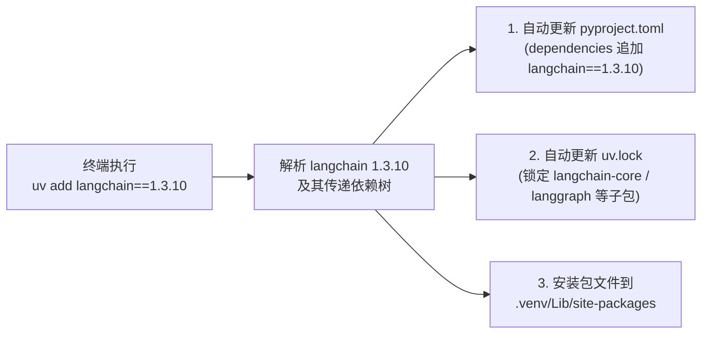

# `uv添加依赖.sh` 源码精讲：使用 `uv add` 精确安装并记录核心依赖包 `langchain`

---

## 一、文件定位与核心前置知识精讲

### 1.1 文件定位
`前置知识/1-uv环境管理工具/uv添加依赖.sh` 是 `1-uv环境管理工具` 模块的**第 4 步**。在 `.venv` 虚拟环境创建并锁定 Python 版本之后，本脚本演示如何使用 `uv add` 命令为项目安装第一个核心 AI 框架依赖——精确锁定版本的 **`langchain==1.3.10`**。

### 1.2 核心前置知识
1. **`uv add <包名>==<版本号>` 背后的三大原子动作**
   与传统的 `pip install langchain==1.3.10` 只往 `site-packages` 塞文件不同，`uv add langchain==1.3.10` 会一次性自动完成三个动作：
   - **动作一（修改工程清单）**：自动把 `"langchain==1.3.10"` 追加到项目根目录 `pyproject.toml` 的 `[project] -> dependencies` 列表中；
   - **动作二（全树解析与锁定）**：利用 PubGrub 算法解析 `langchain 1.3.10` 依赖的所有子包（如 `langchain-core`、`langgraph`、`pydantic`、`PyYAML` 等），并将整棵依赖树的具体版本与哈希值写入 `uv.lock`；
   - **动作三（虚拟环境落盘）**：将下载/缓存好的包极速安装到当前项目的 `.venv\Lib\site-packages` 目录中。
2. **为什么要使用 `==1.3.10` 精确锁定版本？**
   - LangChain 生态迭代极快（从 `0.1.x`、`0.2.x`、`0.3.x` 到 `1.x`，API 诸如 `create_agent`、`bind_tools` 发生过重大变更）。
   - 如果只写 `uv add langchain`（不带版本号），不同时间安装的同学会拉取到不同的最新版，导致后续代码（如 `from langchain.agents import create_agent`）出现导包失败或接口不一致。通过 `==1.3.10` 强行锁定版本，确保所有人运行环境 100% 一致。

### 1.3 在 Voyage 智途主项目中的关联
- 打开主项目根目录下的 [`pyproject.toml`](../../根目录入口与配置/pyproject.toml.md) 和 [`requirements.txt`](../../根目录入口与配置/requirements.txt.md)，第一项核心依赖正是本脚本安装的 `langchain==1.3.10`：
  ```toml
  dependencies = [
      "langchain==1.3.10",
      "pyrefly>=0.60.0",
      "setuptools==79.0.1",
  ]
  ```
- 在前置知识模块 2（[`04-agent_tools.py`](../2-Function%20Call/04-agent_tools.py.md)）以及主项目四大 A2A 子智能体服务（如 [`a2a_server/a2a_weather.py`](../../a2a_server/a2a_weather.py.md)）中，核心智能体构建函数 `from langchain.agents import create_agent` 均由该包提供。

---

## 二、执行流程与示意图

### 2.1 执行流程图（Mermaid）



### 2.2 `uv add` 联动更新三方状态示意图（ASCII）

```text
                [ 执行命令: uv add langchain==1.3.10 ]
                                  |
         +------------------------+------------------------+
         |                        |                        |
         v                        v                        v
+------------------+    +-------------------+    +--------------------+
|  pyproject.toml  |    |      uv.lock      |    |       .venv/       |
| ---------------- |    | ----------------- |    | ------------------ |
| dependencies = [ |    | [[package]]       |    | Lib/site-packages/ |
|   "langchain     |    | name = "langchain"|    |  ├── langchain/    |
|    ==1.3.10",    |    | version = "1.3.10"|    |  ├── langchain_core|
| ]                |    | dependencies = .. |    |  └── langgraph/    |
+------------------+    +-------------------+    +--------------------+
```

---

## 三、完整源码与逐行/逐段深度拆解

### 3.1 完整源码（100% 原始文件嵌入）

文件路径：`前置知识/1-uv环境管理工具/uv添加依赖.sh`

```bash
uv add langchain==1.3.10
```

---

### 3.2 逐行深度拆解

| 行号 | 源码内容 | 深度技术拆解 |
| :--- | :--- | :--- |
| **第 1 行** | `uv add langchain==1.3.10` | **添加项目依赖核心指令**：<br/>• `uv add`：向当前 `uv` 工程添加一个新的生产环境直接依赖（自动同步修改 `pyproject.toml`、`uv.lock` 和 `.venv`）。<br/>• `langchain`：目标 PyPI 包名，即构建 LLM 与 Agent 应用的核心编排框架。<br/>• `==1.3.10`：PEP 440 精确版本匹配操作符，指定必须安装 `1.3.10` 版本。 |

---

### 3.3 沙盘推演（Dry Run）：执行前后 `pyproject.toml` 与控制台的变化

1. **执行前 `pyproject.toml` 的状态**：
   ```toml
   [project]
   name = "myproject"
   version = "0.1.0"
   requires-python = ">=3.10"
   dependencies = []
   ```

2. **在项目根目录终端执行命令**：
   ```text
   > uv add langchain==1.3.10
   Resolved 32 packages in 480ms
   Prepared 15 packages in 1.25s
   Installed 28 packages in 320ms
    + langchain==1.3.10
    + langchain-core==1.3.15
    + langgraph==1.1.4
    + pydantic==2.11.4
    + pyyaml==6.0.2
    ... (其余子依赖自动安装)
   ```

3. **执行后 `pyproject.toml` 的状态（自动修改）**：
   ```toml
   [project]
   name = "myproject"
   version = "0.1.0"
   requires-python = ">=3.10"
   dependencies = [
       "langchain==1.3.10",
   ]
   ```
   注意：虽然 `.venv` 中实际安装了 28 个包（含所有底层子依赖），但 `pyproject.toml` 的 `dependencies` 只会干净地记录你显式请求的顶层直接依赖 `"langchain==1.3.10"`，而那 28 个包的完整精确版本全部被记录在 `uv.lock` 中！这种“**声明文件保持清爽、锁文件保持精确**”的设计正是现代包管理的精髓。

---

## 四、常见易错点与对比总结

### 4.1 `uv add` vs `uv pip install` vs `pip install` 对比

| 命令 | 是否安装到 `.venv` | 是否自动写入 `pyproject.toml` | 是否自动更新 `uv.lock` | 推荐指数 |
| :--- | :--- | :--- | :--- | :--- |
| **`uv add langchain==1.3.10`（本脚本）** | **是** | **是** | **是** | ⭐⭐⭐⭐⭐（标准工程首选） |
| `uv pip install langchain==1.3.10` | 是 | **否**（下次 `uv sync` 会被删掉！） | **否** | ⭐⭐（仅用于临时非工程脚本调试） |
| `pip install langchain==1.3.10` | 取决于是否手动 `activate` 了虚拟环境 | **否** | **否** | ⭐（容易误装到全局，不推荐） |

### 4.2 新手最容易踩的 2 个坑

1. **下载缓慢或超时（未配置国内镜像源）**：
   - 如果直接运行 `uv add langchain==1.3.10` 下载很慢，可以在 `pyproject.toml` 末尾加上阿里云镜像配置（与主项目 [`pyproject.toml`](../../根目录入口与配置/pyproject.toml.md) 相同）：
     ```toml
     [tool.uv]
     index-url = "https://mirrors.aliyun.com/pypi/simple/"
     ```
   - 或者在命令行临时附加参数：`uv add langchain==1.3.10 --default-index https://mirrors.aliyun.com/pypi/simple/`。
2. **版本号两边多敲了空格**：
   - 错误写法：`uv add langchain == 1.3.10`（中间有空格会被 Shell 当成 3 个独立包名参数而报错）。
   - 正确写法：`uv add langchain==1.3.10`（紧密相连，无空格）。

---

## 五、自测思考题（附答案解析）

### 思考题 1
执行 `uv add langchain==1.3.10` 后，`uv` 自动顺带安装了 `langchain-core`、`pydantic` 等二十多个底层依赖包。为什么打开 `pyproject.toml` 却只看到 `"langchain==1.3.10"` 一行？那二十多个子依赖包的版本信息去哪儿了？

<details>
<summary>点击查看答案解析</summary>

**答案解析**：
1. `pyproject.toml` 的 `dependencies` 专门用于记录**项目的顶层直接依赖（Direct Dependencies）**，保持简洁可读，方便开发者维护。
2. 那二十多个间接传递依赖（Transitive Dependencies）的精确版本号、依赖关系以及文件 SHA256 校验值，全部被自动记录在了项目根目录的 **`uv.lock`** 锁文件中。
</details>

### 思考题 2
如果不小心装错了包或者版本（比如想把某个包从项目依赖中彻底移除），在 `uv` 中应该用什么命令？

<details>
<summary>点击查看答案解析</summary>

**答案解析**：
应该使用 **`uv remove <包名>`**（例如 `uv remove langchain`）。它会自动将该包从 `pyproject.toml` 中移除、更新 `uv.lock`，并同时把该包及其不再被需要的子依赖从 `.venv` 虚拟环境中卸载干净。如果要升级/更改版本，只需直接重新运行 `uv add langchain==新版本号` 即可自动覆盖。
</details>
