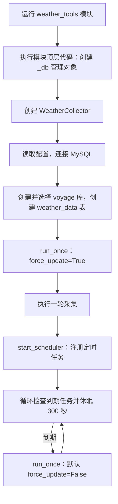
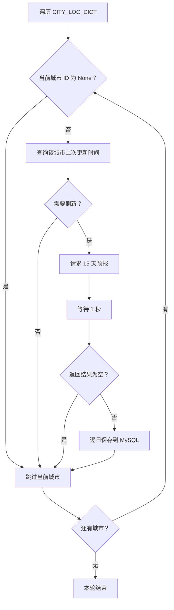
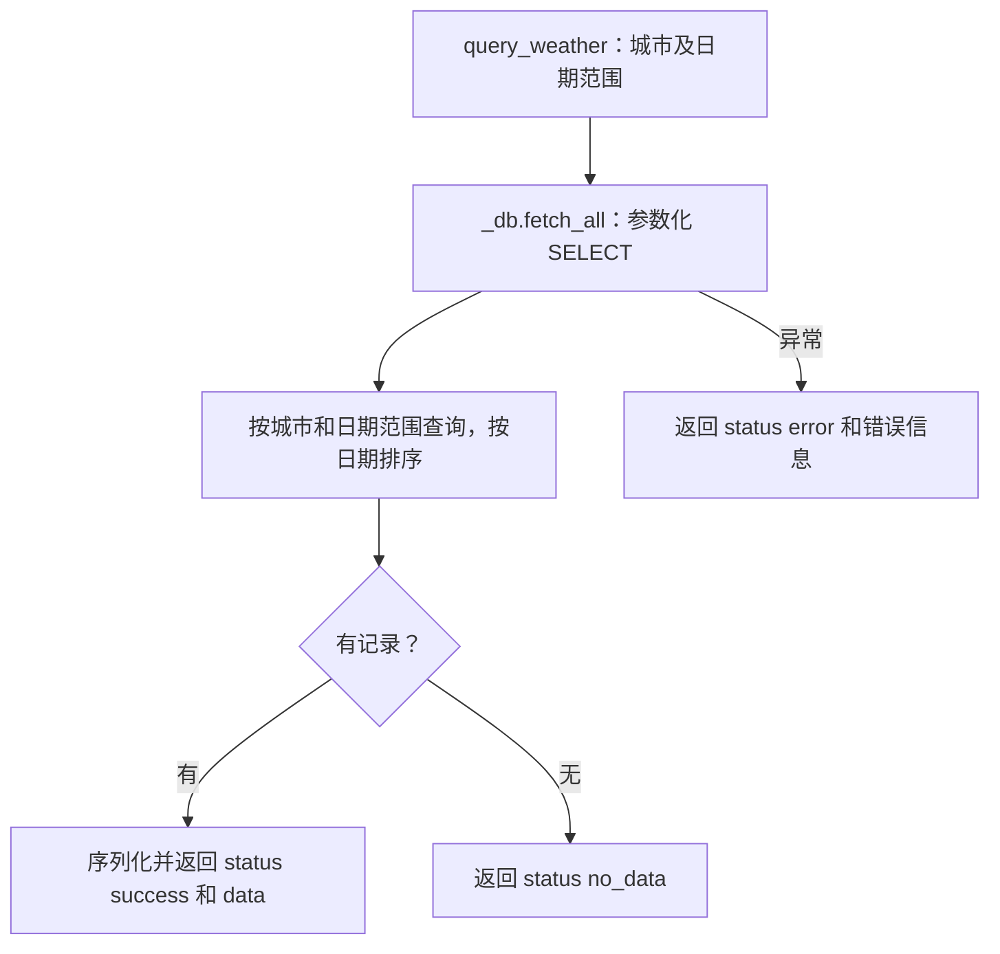
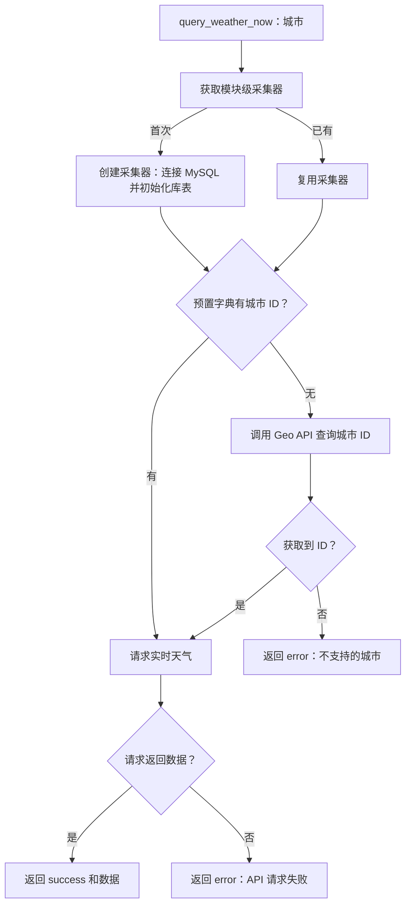

# MCP工具层-weather_tool

# 天气工具与工具注册调用流程

本文按当前代码说明，从入口往下追踪。箭头 `→` 表示调用或执行顺序；`[MySQL]`、`[HTTP]` 表示访问外部系统。源代码：[weather_tools.py](mcp_tools/weather_tools.py)。

## 一、先看所有入口

```text
入口 / 公共函数                    调用的函数或方法                 最底层动作
──────────────────────────────────────────────────────────────────────────────
导入 weather_tools 模块          → MySQLManager()               → 创建管理对象，暂不连接
python -m mcp_tools.weather_tools → WeatherCollector()           → [MySQL] 连接、建库、建表
                                 → run_once(True)               → 采集并保存一轮
                                 → start_scheduler()            → 定时循环
query_weather(...)               → _db.fetch_all(...)            → [MySQL] 查询预报表
query_weather_now(city)          → _get_weather_collector()     → 首次创建采集器
                                 → get_city_location_id(...)    → [HTTP] 查城市 ID（按需）
                                 → get_weather_now(...)          → [HTTP] 查实时天气
WeatherCollector.run_once(...)   → 各采集辅助方法                → [MySQL] + [HTTP]
WeatherCollector.start_scheduler() → schedule.run_pending()      → 到点调用 run_once()
```

`query_weather` 和 `query_weather_now` 是给外部调用的两个天气工具；`WeatherCollector` 的公开方法也可以在 Python 中被直接调用。模块导入时创建的是 `_db` 管理对象，不等于已建立连接；真正查询时 `fetch_all()` 才确保当前线程连接可用。

## 二、独立运行入口：采集并定时更新

入口：`python -m mcp_tools.weather_tools`，对应 [weather_tools.py:637](mcp_tools/weather_tools.py#L637)。先执行模块顶层代码，再进入 `__main__`。



### 2.1 创建采集器 `WeatherCollector()`

入口：[weather_tools.py:130](mcp_tools/weather_tools.py#L130)。

```text
WeatherCollector.__init__()
  → 从 CONFIG 读取时区、和风 API 配置和 MySQL 配置
  → 设置超时 30 秒、15 天预报、更新间隔 1440 分钟、检查间隔 300 秒
  → 设置六个预置城市及其 location ID
  → pymysql.connect(...) → 创建 cursor                         [MySQL]
  → _create_db() → CREATE DATABASE IF NOT EXISTS → USE voyage [MySQL]
  → _create_table() → CREATE TABLE IF NOT EXISTS weather_data [MySQL]
```

表中 `(city, fx_date)` 是唯一键；采集器连接开启自动提交。初始化连接或建表失败会向调用方抛异常。

### 2.2 一轮采集 `run_once(force_update=False)`

入口：[weather_tools.py:472](mcp_tools/weather_tools.py#L472)。`__main__` 首轮传 `True`，定时任务使用默认值 `False`。



详细调用：

```text
run_once(force_update)
  → 依次读取 CITY_LOC_DICT 中的 city_name、loc_id
  → loc_id 为 None：记录日志，跳过该城市
  → _get_last_update_time(city_name)
      → _ensure_connection()：ping，断线则重新 connect 和创建 cursor
      → SELECT MAX(update_time) WHERE city = %s               [MySQL]
      → 返回最新时间或 None
  → _need_refresh(last_dt, force_update)
      → force_update 为 True，或没有历史时间：需要更新
      → 否则比较配置时区下的当前时间和上次时间
      → 间隔 ≥ 1440 分钟：需要更新；否则跳过
  → get_weather_data(loc_id)
      → GET /v7/weather/15d，携带 API key，超时 30 秒          [HTTP]
      → HTTP 200 返回 JSON；其他状态或异常返回 None
  → sleep(1)；结果为空则跳过保存
  → save_weather(city_name, ret_dict)
      → 解析 updateTime，遍历 daily 中每天的数据
      → 解析 fxDate，整理成与表字段对应的参数
      → 每天先 _ensure_connection()，再执行 INSERT             [MySQL]
      → city + fx_date 重复时 ON DUPLICATE KEY UPDATE 更新原记录
  → 当前城市出错：记录异常，继续下一个城市
```

外层还有一次全局异常捕获。`get_weather_data()` 依据 HTTP 状态判断，不额外检查和风响应中的业务 `code`；保存阶段的数据解析或数据库异常由当前城市的异常处理捕获。

### 2.3 定时入口 `start_scheduler()`

入口：[weather_tools.py:521](mcp_tools/weather_tools.py#L521)。

```text
start_scheduler()
  → schedule.every(1440).minutes.do(self.run_once)
  → while True
      → schedule.run_pending()：到期才运行 run_once()
      → sleep(300)：等待 5 分钟再检查
```

这是持续运行的循环，不会自行返回。`run_once` 本身也能被其他代码直接调用，调用时无需先启动调度器。

## 三、查询数据库入口 `query_weather`

入口：[weather_tools.py:546](mcp_tools/weather_tools.py#L546)。输入城市、开始日期、结束日期；返回 JSON **字符串**。



```text
query_weather(city, start_date, end_date)
  → _db.fetch_all(sql, params=(city, start_date, end_date))
      → ensure_connection() → is_alive()；必要时 _connect()   [MySQL]
      → 参数化 SELECT：city 相等、fx_date 在日期范围内，按日期升序
      → fetchall()，按列名转换为字典列表
      → finally 默认关闭当前线程的连接和游标
  → 有记录：json.dumps(status=success, data=rows)
      → DateDecimalToString 处理日期、Decimal 等类型
  → 无记录：json.dumps(status=no_data, message=...)
  → 查询或序列化异常：json.dumps(status=error, message=...)
```

这里查的是已入库的预报，不会自动发起采集或实时天气请求。`MySQLManager` 使用线程局部连接，见 [mysql_manager.py:94](utils/mysql_manager.py#L94)。

## 四、实时天气入口 `query_weather_now`

入口：[weather_tools.py:600](mcp_tools/weather_tools.py#L600)。输入城市；返回 JSON **字符串**。



```text
query_weather_now(city)
  → _get_weather_collector()
      → 模块级 _weather_collector 为 None：创建 WeatherCollector()
      → 否则复用已有对象
  → CITY_LOC_DICT.get(city)
  → 未取得 ID：get_city_location_id(city)
      → GET /geo/v2/city/lookup?location=城市                 [HTTP]
      → HTTP 200 时取 location[0].id；非 200 或异常返回 None
      → 仍为 None：返回 status=error
  → get_weather_now(loc_id)
      → GET /v7/weather/now?location=ID                     [HTTP]
      → HTTP 200 返回 JSON；非 200 或异常返回 None
  → 有结果：返回 status=success 和 data；无结果：返回 status=error
  → try 内其他异常：记录并返回 status=error
```

注意：`_get_weather_collector()` 在 `try` 之前，首次初始化失败不会被这里的 `except` 转为 JSON。动态查到的城市 ID 没有写回字典，下次查询该城市仍会查 Geo API。实时查询首次也依赖 MySQL 初始化，尽管天气本身来自 HTTP。

## 五、四个工具框架文件：最简单调用链

你写了两次 `tool_config`；这里按项目中与其配套的第四个文件 **`tool_init.py`** 解释。

| 文件 | 一句话理解 | 负责什么 |
| --- | --- | --- |
| [tool_base.py](core/tool_base.py) | 统一规格 | 规定工具名称、描述、参数、执行方法；`safe_execute` 做简单必填校验和异常包装。 |
| [tool_config.py](core/tool_config.py) | 开关 | 从项目根目录 `config.yaml` 读取工具配置，判断是否启用；未配置默认启用。 |
| [tool_registry.py](core/tool_registry.py) | 工具名册 | 注册工具、按名称查找、按业务域列出工具。 |
| [tool_init.py](core/tool_init.py) | 装配工 | 导入业务函数，检查开关，用 `FunctionTool` 包装后放进名册。 |

### 5.1 项目实际发生的注册链

```text
main_http_api.py 启动事件
  → init_tools()                                          [tool_init.py]
      → 导入 query_weather / query_weather_now             [weather_tools.py]
      → _register_if_enabled(工具名称, ..., 业务函数)      [tool_init.py]
          → TOOL_CONFIG.is_enabled(工具名称)               [tool_config.py]
          → 关闭：跳过；开启：FunctionTool(...) 包装业务函数
              → FunctionTool 继承 ToolBase                [tool_base.py]
          → TOOL_REGISTRY.register(工具对象)               [tool_registry.py]
              → 检查重名、检查 enabled → 保存到 _tools 字典
```

例如 `query_weather` 注册完成后，可以把名册想成：`{"query_weather": 包装后的工具对象, ...}`。启动入口见 [main_http_api.py:346](main_http_api.py#L346)，天气注册见 [tool_init.py:138](core/tool_init.py#L138)。

项目中实际的工具列表查询：

```text
GET /api/tools
  → TOOL_REGISTRY.discover(domain)
  → 根据可选 domain 筛选并返回已注册工具的信息
```

见 [main_http_api.py:324](main_http_api.py#L324)。

### 5.2 这套框架提供的执行方式

如果调用方需要通过名册执行，代码提供的链路是：

```text
TOOL_REGISTRY.get("query_weather")
  → await 工具.safe_execute(city=..., start_date=..., end_date=...)
      → ToolBase.validate_params() 检查 schema 的 required
      → FunctionTool.execute(**kwargs)
          → 同步业务函数在线程池运行；异步函数直接 await
          → query_weather(...) → 查 MySQL
      → 包装为 {status: success, data: 业务函数返回值}；异常包装为 error
```

这是框架**可用的调用方式**，仓库中未发现业务代码实际通过 `registry.get()` → `safe_execute()` 执行天气的调用点。天气注册时没有传参数 schema，默认空 schema，所以这里的 `validate_params()` 不会预先检查天气函数的必填参数；最终调用函数时仍可能因参数不足报错。`safe_execute` 的成功包装表示函数正常返回，即使业务函数返回的 JSON 字符串内部是 `status=error`，外层仍可能是 `success`。

### 5.3 当前天气 MCP 的真实链路

```text
天气 Agent → MultiServerMCPClient.get_tools()
  → mcp_server/mcp_weather.py 中 FastMCP 注册的天气工具
  → query_weather(...) 或 query_weather_now(...)
  → MySQL 或和风天气 API
```

见 [a2a_weather.py:139](a2a_server/a2a_weather.py#L139) 和 [mcp_weather.py:19](mcp_server/mcp_weather.py#L19)。这条 MCP 路径直接注册业务函数，不经过上面的 `ToolRegistry` 和 `FunctionTool`；因此不能认为 `tool_config.py` 的开关会自动控制这个 MCP 服务暴露的工具。

## 六、读代码时值得留意

1. `WeatherCollector._ensure_connection()` 重连后只重新创建连接和游标，没有再次执行 `USE voyage`；由于其连接配置没有指定数据库，重连后的 SQL 可能报未选择数据库。
2. 采集器的 `__del__()` 尝试关闭游标和连接，异常被忽略；它是销毁时的兜底，并非定时循环的退出机制。
3. 预报和实时天气接口只按 HTTP 状态判断成功，不保证接口业务结果一定成功。
